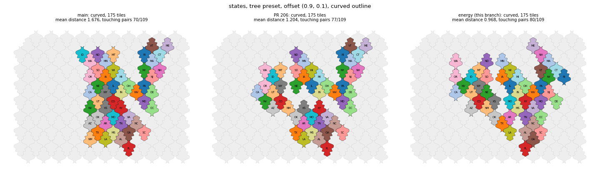
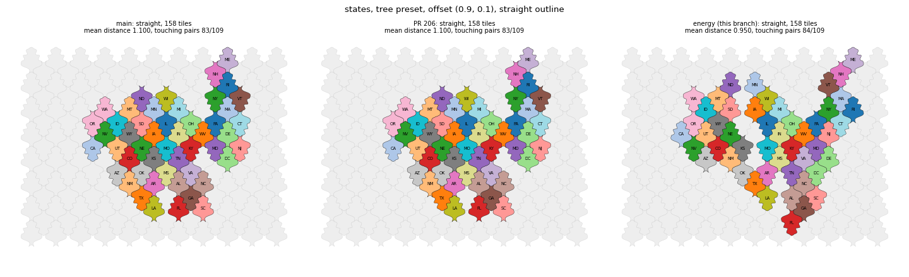
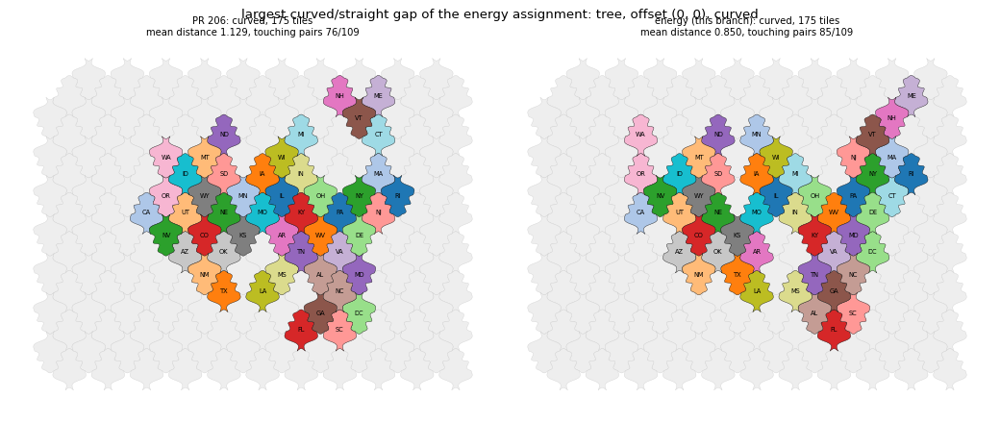
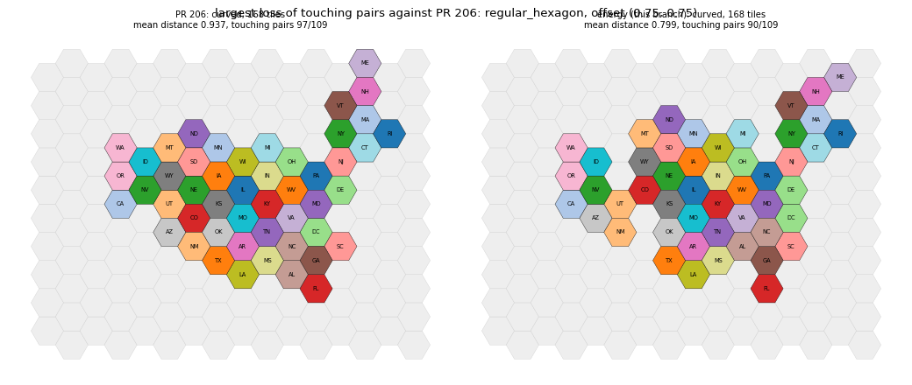
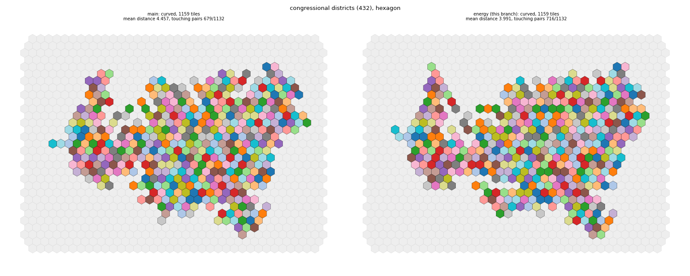
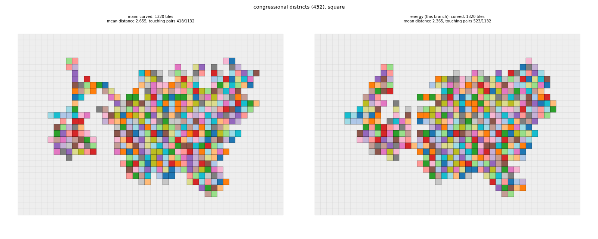

## Change

Draft, part of #198. Built on the branch of PR 206; the diff against main includes it.

- New option `assignment="energy"` (default); the previous pipeline stays available as `"refine"`. Code in `symbol_cartogram/layouts/grid/_energy.py`.
- Energy, in tile steps: `origin_weight` x sum of distances (linear) + `neighbor_weight` x contact penalty + `connectivity_weight` x K. The contact penalty is the hop penalty of neighbors plus 1 per pair of non-neighbors on touching tiles. K counts the extra pieces of a group of connected regions, groups merged into one piece, and enclosed holes beyond the geographic holes.
- Optimizer: start from the Hungarian assignment with the neighbor term damped by 0.5 (its origin cost is divided by the squared centroid extent instead of the maximum over all tiles, so margin tiles do not change it), then a strict descent: relocations and swaps (top 3 each) with the exact change of the energy, and while K > 0 the cheapest move that removes a defect (a repair tile, a shift chain that fills a hole, or moving a detached piece). A move is applied only if the energy drops, so the descent is monotone and deterministic.
- Weights: `origin_weight` and `neighbor_weight` keep 0.5 each (one tile step costs one contact); `connectivity_weight` is 50 (one defect costs 100 contacts).
- Removed from the default path: the undamped refinement, the island fix, the hole fill; the candidate radius of the review was not merged.

## Weight scan (180 states runs)

- Distance per contact 0.5 / 1 / 2: mean distance 0.798 / 0.793 / 0.768, touching pairs 71.77 / 71.77 / 71.33, maximum gap between curved and straight outline 14 / 14 / 20 %. A weight of 1 is the knee; lower weights buy no contacts.
- Defect weight 10 / 30 / 100 / 300 contacts: states are identical from 30 up; districts keep defects at 10 (2 pieces, 1 to 2 holes) and have none from 30 up.

## Results

| | main | PR 206 | energy |
|---|---|---|---|
| Mean distance (180 runs) | 0.898 | 0.893 | 0.793 |
| Touching pairs (of 109) | 68.43 | 68.36 | 71.77 |
| Disconnected tile sets / runs with holes | 0 / 0 after the repairs | 0 / 2 after the repairs | 0 / 0, no repairs |
| Cases more than 25 % apart, curved against straight | 1 | 0 | 0 |
| Largest gap | 52 % | 9.5 % | 14.2 % (tree at (0, 0)) |
| tree (0.9, 0.1), 175 / 158 tiles | 1.676 / 1.100 | 1.204 / 1.100 | 0.968 / 0.950 |
| States time, mean (serial) | 0.30 s | not timed | 0.45 s (1.48x; worst run 2.1x) |
| Districts, hexagon: distance / touching / time | 4.457 / 679 / 4.0 s | 4.457 / 679 | 3.991 / 716 / 5.2 s |
| Districts, square: distance / touching / holes / time | 2.655 / 418 / 2 / 4.3 s | 2.651 / 468 / 1 | 2.365 / 523 / 0 / 5.1 s |

Against PR 206, run by run: the mean distance is worse in 14 of 180 runs (at most +0.039); the touching pairs are fewer in 32 of 180 (at most -7; for example the hexagon presets at offset (0.75, 0.75) get 90 instead of 97 pairs at a mean distance of 0.80 instead of 0.94); both are worse in 2 runs. Two runs take more than twice the time of main. Results are identical between runs.

## Distance scale

Dividing by the maximum squared distance ties the price of distance to the extent of the lattice, margin tiles included; for the states one tile step costs about 0.002. In tile units the exponent barely changes the trade-off between distance and contacts; the energy uses linear distance so that every tile step has a constant price equal to one contact. For the mosaic layout this suggests that the maximum, not the square, is the problem; changing to linear over the maximum also changes the effective weight, which may explain the clash with `interior_bonus` in the earlier evaluation. The mosaic layout was not changed or tested.

Figures (main, PR 206, energy):

## Risks and open points

- Every default grid layout changes.
- `topology_weight` and compactness only shape the starting assignment now.
- Defects are removed only if one of the compound moves reaches them; wide gaps are not guaranteed to close.
- Not established: mosaic, world and island inputs (multi-group K is tested only on toy cases), grouped (`source_indices`) inputs, and whether the balance of distance and contacts suits users.
