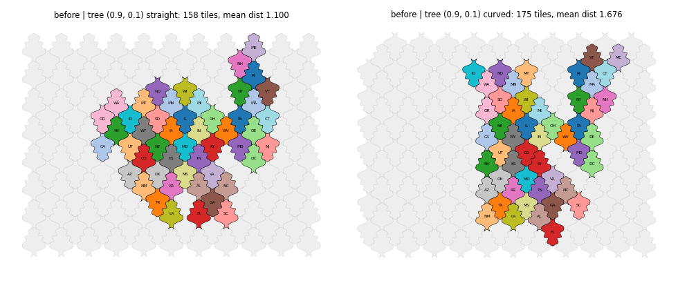
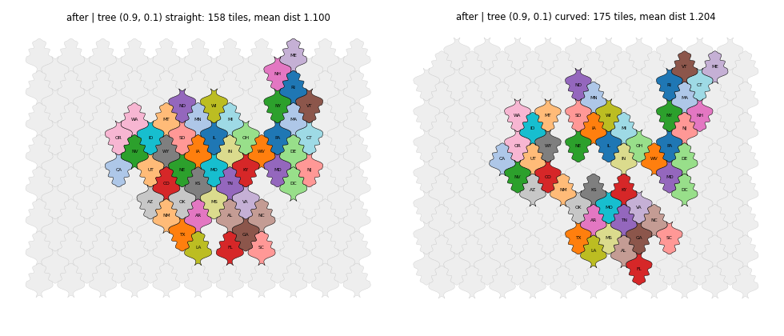
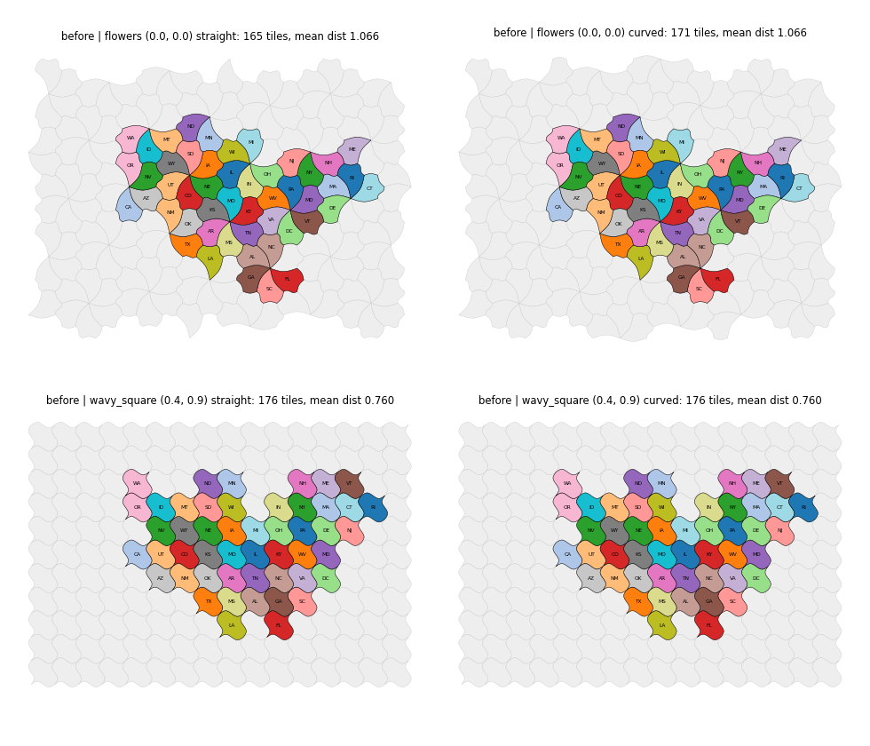
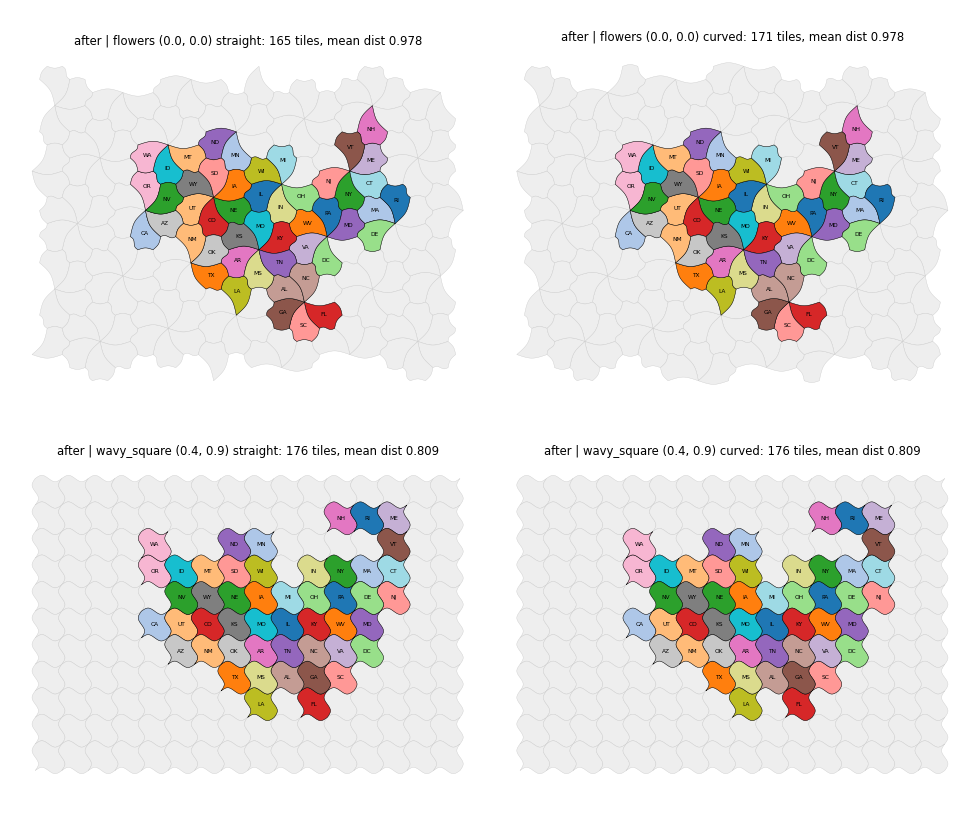

## Change

Part of #198; the acceptance of the issue is not fully met (see below).

- `_fix_island_assignments` in `_placement.py`: if a free tile touches both the main group and a separated block, one region of the block moves onto it; the region is chosen by the smallest cost (increase of the distance in tile steps plus lost contacts with neighbor regions), and the step repeats. The old rule (each region of the block moves to the nearest free tile next to the main group) remains as fallback.
- `tests/test_grid_fix_islands.py`, changelog entry under Fixed.

## Cause

The Hungarian refinement alternates between two assignments from about the fifth pass on both lattices, but its result is not the cause: after refinement the mean distances are 1.092 (158 tiles) and 1.139 (175 tiles). Stopping at a cycle or keeping the best assignment seen leaves tree on 175 tiles at 1.676 and changes 111 of 180 runs, 53 of them to a worse mean distance; this was not adopted.

After hole filling the mean distance is 1.196. On the 175-tile lattice an 11-state western block is separated from the main group by a gap of one free tile, and the island fix moves each of its regions to the nearest free tile next to the main group (+0.48 mean distance). On the 158-tile lattice there is no gap and nothing moves.

## Results

| Case | Before | After |
|---|---|---|
| tree (0.9, 0.1), mean distance, 158 / 175 tiles | 1.100 / 1.676 | 1.100 / 1.204 |
| tree (0.9, 0.1), touching pairs, 158 / 175 tiles | 83 / 70 | 83 / 77 |
| Cases with more than 25 % difference between the two tile sets | 1 (max 52 %) | 0 (max 9.5 %) |
| Mean distance, mean over all 180 runs | 0.8981 | 0.8925 |
| Touching pairs, mean over all 180 runs | 68.43 | 68.36 |

Of the 22 curved cases that change, the mean distance is better in 17 and worse in 5 (worst +0.049: wavy_square at (0.4, 0.9), 0.760 to 0.809); touching pairs are better in 3 and worse in 9 (worst -3). Largest improvements: tree (0.9, 0.1) -0.473, flowers (0, 0) 1.066 to 0.978, scalloped_quad (0.5, 0.25) 0.968 to 0.925. Touching-pair counts vary by about 3 with small layout changes. The count here uses 109 edge-adjacent pairs (the issue uses 107).

Figures (left: straight outline, 158 tiles; right: curved outline, 175 tiles):

## Not met

- The acceptance "no case gets worse" is not met: 5 cases get a worse mean distance and 9 a worse touching count, all by small amounts.
- Tree on 158 and on 175 tiles still differ (1.100 and 1.204) because the unused margin tiles still enter the refinement. Excluding them needs knowledge of the outline that the placement step does not have.
- Gaps wider than one tile use the old rule. Mosaic and district inputs were not checked.
