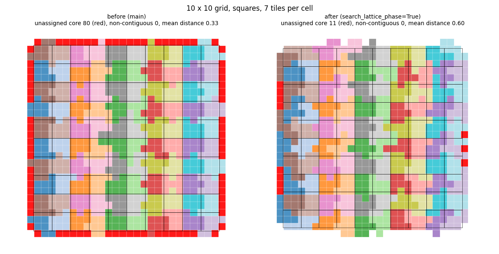
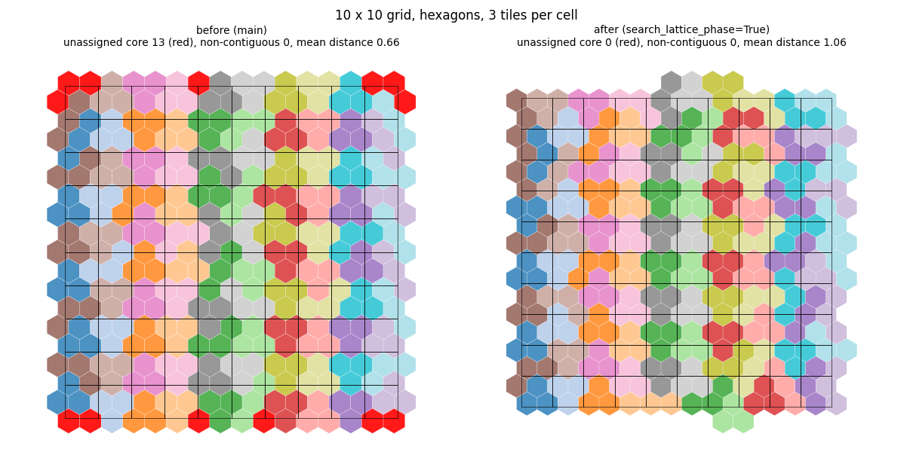
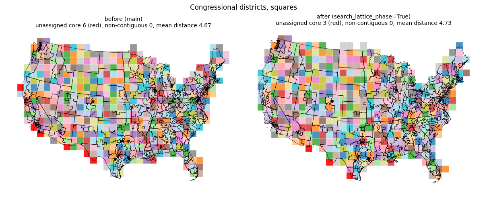

## Change

Part of #192.

- `MosaicLayoutOptions.search_lattice_phase` (default `False`): if calibration ends with more than one core tile above the budget, the calibration is repeated with seven additional lattice phases added to the offset; the first phase with an excess of at most one is kept, else the one with the smallest excess.
- `calibrate_lattice_phase` in `_calibration.py`; two tests; changelog entry.
- Default off, so existing layouts and the golden fixtures are unchanged.

## What the unassigned core tiles are

No run has an enclosed hole. Every unassigned core tile is a boundary tile with low overlap with the study area: about 0.1 on the grids (a frame of sliver tiles; the 80 tiles at k = 7 on squares total an overlap of 8.9) and 0.1 to 0.5 on states and districts. The count of unassigned core tiles therefore overstates the problem. On states and districts calibration ends within 1 to 5 tiles of the budget (states, hexagons: 153 core tiles against 154), so the step-jump cause from the issue does not apply there; the assignment prefers ring tiles closer to the demand of the regions.

## Results with `search_lattice_phase=True`

| Input | Unassigned core | Non-contiguous | Mean distance | Total time (s) | Calibration time (s) | Calibrations |
|---|---|---|---|---|---|---|
| Grid squares, k = 3 | 20 -> 0 | 4 -> 0 | 0.53 -> 0.51 | 0.75 -> 1.74 | 0.34 -> 1.40 | 1 -> 4 |
| Grid squares, k = 7 | 80 -> 11 | 0 -> 0 | 0.33 -> 0.60 | 1.5 -> 3.3 | 0.69 -> 1.49 | 1 -> 2 |
| Grid squares, k = 8 | 96 -> 0 | 0 -> 0 | 0.33 -> 0.61 | 1.7 -> 4.8 | 0.83 -> 3.3 | 1 -> 4 |
| Grid hexagons, k = 3 | 13 -> 0 | 0 -> 0 | 0.66 -> 1.06 | 0.82 -> 1.25 | 0.44 -> 0.85 | 1 -> 2 |
| Grid hexagons, k = 6 | 35 -> 1 | 0 -> 0 | 0.56 -> 0.72 | 1.6 -> 2.4 | 0.78 -> 1.58 | 1 -> 2 |
| Grid hexagons, k = 8 | 21 -> 0 | 0 -> 0 | 0.86 -> 0.50 | 2.7 -> 2.9 | 0.99 -> 1.73 | 1 -> 2 |
| States, squares | 1 -> 1 | 0 -> 0 | 2.55 -> 2.55 | 1.2 -> 1.3 | 0.33 -> 0.42 | 1 -> 1 |
| States, hexagons | 10 -> 5 | 0 -> 0 | 3.37 -> 3.38 | 2.2 -> 2.6 | 1.35 -> 1.72 | 1 -> 2 |
| Districts, squares | 6 -> 3 | 0 -> 0 | 4.67 -> 4.73 | 6.3 -> 9.8 | 3.0 -> 6.0 | 1 -> 2 |
| Districts, hexagons | 13 -> 13 | 0 -> 0 | 6.91 -> 6.91 | 7.7 -> 8.1 | 0.87 -> 0.86 | 1 -> 1 |

- The search adds no hole and no non-contiguous region.
- It triggers on the grids, states with hexagons and districts with squares; it does not trigger on states with squares and districts with hexagons.
- When it triggers, calibration takes about twice as long, up to four times on the grid.
- Mean distance is worse on four of the six grid cases (squares k = 7 and 8, hexagons k = 3 and 6): the sliver tiles at the boundary are replaced by tiles at a different phase, and the outline is less straight.

Figures (before and after, unassigned core tiles in red): `grid-squares-k7.png`, `grid-hexagons-k3.png`, `districts-squares.png`.

## Other options tested (single runs, morph=False)

- `min_overlap_frac` of 0.2, 0.3 and 0.5 lowers the unassigned count on hexagons (states 10 -> 1, 2, 2; districts 13 -> 7, 3, 2) and raises the mean distance (states 3.37 -> 4.9, 4.3, 4.9; districts 6.91 -> 7.5, 8.1, 8.7). On squares at 0.5 states gets 4 unassigned tiles and 3 split regions.
- `ring_swapback_max_hops` of 64 changes the count by at most 2.
- Trimming or adding tiles to the exact budget makes some inputs worse than today (grid hexagons at k = 10: 0 -> 8 unassigned; states with hexagons: mean distance 3.37 -> 4.40).
- Rotation closes the squares k = 7 case (30 or 45 degrees, 0 unassigned, mean distance 0.33 at 30) but not hexagons k = 6.
