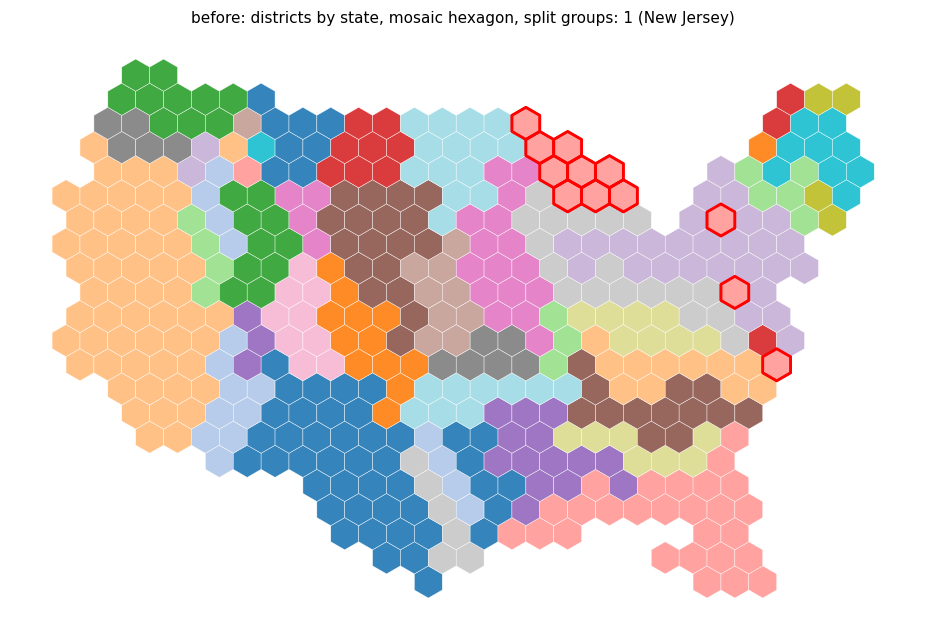
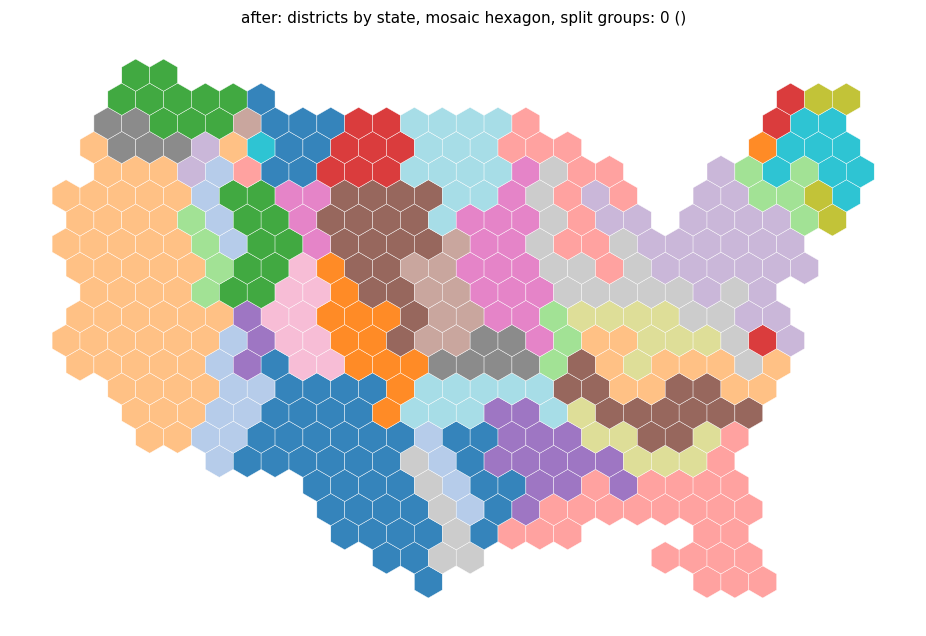
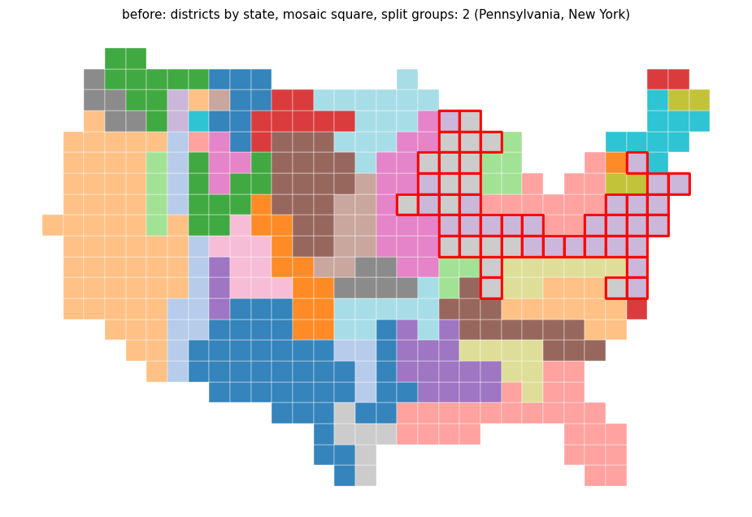
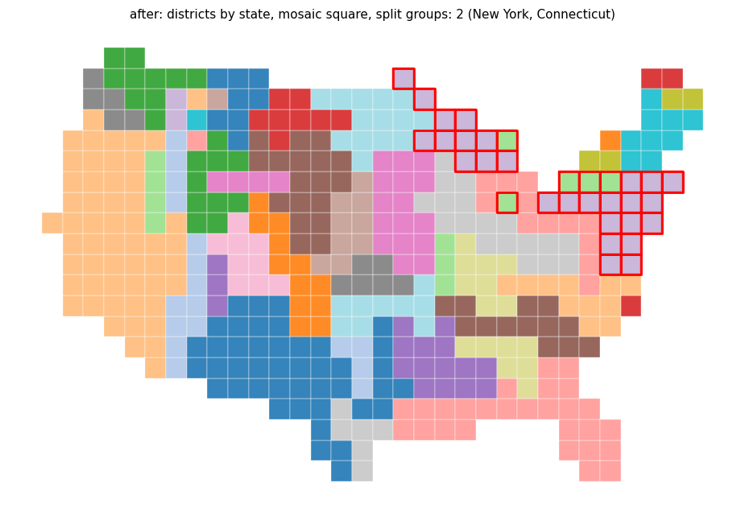

## Change

Part of #191.

- Speedup (`_enumerate_paths` in `geo_utils/contiguity.py`): a backward breadth-first search gives every tile its distance to the main body; the heap is keyed by path length plus that distance, and prefixes that cannot finish within `max_len` are not pushed. Chains and their order are unchanged.
- Satellite bug: the tiles forbidden to a satellite repair were built from `comps[2:]`, but satellites are processed in distance order, so a satellite other than `comps[1]` forbade its own tiles, `comps[1]` was not forbidden, and the satellite found no path. The set is now built from `comps[1:]` minus the current satellite's tiles.
- Guard: a chain is refused if it increases the number of pieces of any other group, including groups that are already split. Before, only contiguous groups were protected; with the satellite fix a repair could re-split another split group and the next pass undid it (on states with 350 regions and squares, two groups alternated from the second pass on).
- Tests: `tests/test_geo_utils_contiguity_search.py` (pruned against plain enumeration, a satellite that is not the second largest component, states with 350 regions and squares); changelog entries.

## Split groups and non-contiguous regions, main -> branch

| Input (mosaic) | Split groups / non-contiguous regions |
|---|---|
| Districts by state, hexagon | 1 / 0 -> 0 / 0 |
| Districts by state, square | 2 / 0 -> 2 / 0 (other groups: PA and NY -> NY and CT) |
| Districts by division, hexagon | 0 / 0 -> 0 / 0 |
| Districts by division, square | 1 / 0 -> 0 / 0 |
| States with 150, 300 (morph) and 350 regions, hexagon | 0 / 0 -> 0 / 0 |
| States with 350 regions, square | 0 / 1 -> 0 / 0 |
| Texas, hexagon and square | 0 / 0 -> 0 / 0 |

With the satellite fix alone, states with 350 regions and squares got worse (2) and districts by division with squares stayed at 1; the guard fixes both. `TestRingSwapbackReach::test_us_states_needs_more_than_8_hops[False-350]` passes at the default 60 candidate paths (the last satellites of one group were blocked on all 60 candidates before; the old code solved it only by path-dependent luck).

## Timings, main -> branch (runs not isolated, noisy)

| Input (mosaic) | Wall time (s) |
|---|---|
| Districts by state, hexagon | 12.7 -> 4.1 |
| Districts by state, square | 10.1 -> 5.6 |
| Districts by division, hexagon | 6.9 -> 3.9 |

Chain repair alone on districts by state with hexagons: 3.79 s -> 0.02 s. `pytest -k "contiguity or mosaic or voronoi or symbol"`: 575 passed.

Figures (split groups outlined in red):

## Open

- Districts by state with squares keeps two split groups. The remaining satellites of groups 29 and 5 are blocked by the contiguous groups 27 and 35 and by each other; 1000 candidate chains give the same result. It needs a move of several groups at once.
- Layout setup time (about 4 s on districts by state with hexagons): tile intersections with the study union about 45 %, tile and geometry adjacency about 26 %. Intersecting only boundary tiles and computing the adjacency once were not tried, because the change is not small.
