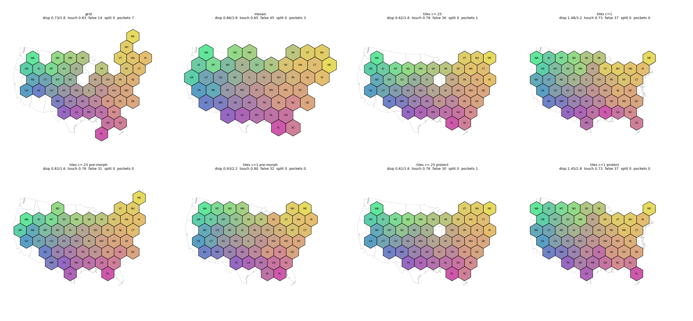
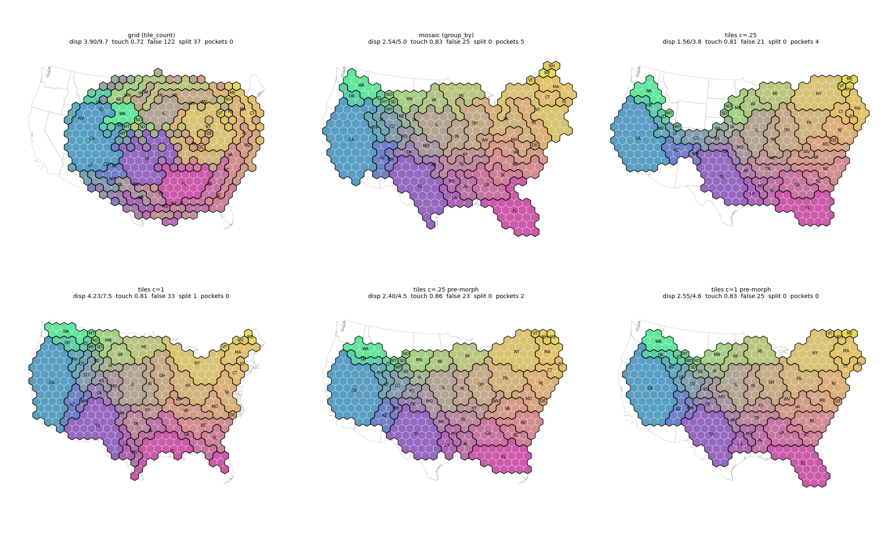
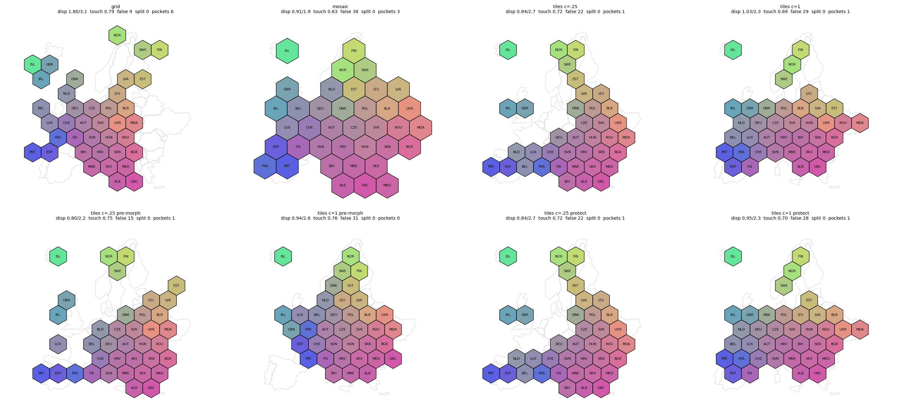
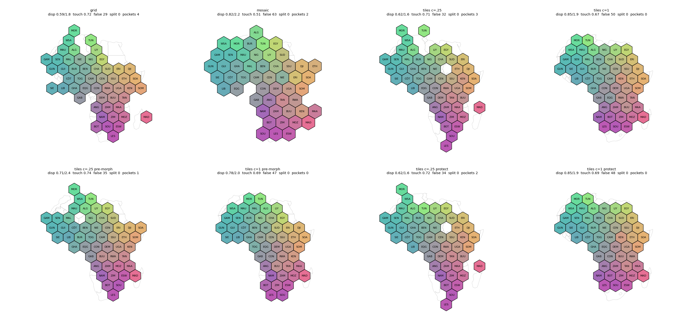

## Change

A new layout `"tiles"` (`TileLayout`) next to `"grid"` and `"mosaic"`. It covers one tile per region, `tile_count` and `group_by` with one allocation and one assignment:
- Allocation: silhouette per land part, compactness on a geometric scale, components `separate | connected | spaced`, part membership enforced from the original geometries.
- Assignment: capacitated optimal transport with a hull reserve sink (capacity 1 for one tile per region), contiguity-guarded swaps and chain moves for groups, contact descent for single tiles, optional `protect_contacts`, optional pre-morph (off by default).
- Neighbors by shared border length: `geo_utils.find_bordering_pairs`.
- Results do not depend on input row order.

## Comparison

Mean/max displacement in tile steps; touching of truly adjacent pairs (plain/border-weighted); false contacts. Districts: groups split / stray tiles are given where nonzero. Truth for all layouts is `find_bordering_pairs` on the same geometries.

| case | grid | mosaic | tiles c=.25 | tiles c=1 | tiles c=1 pre-morph |
|---|---|---|---|---|---|
| States | .73/1.8, .83/.88, 14 | .86/1.8, .65/.74, 45 | .62/1.6, .78/.86, 30 | 1.48/3.2, .73/.79, 37 | .93/2.2, .80/.85, 32 |
| Districts by state | 3.90/9.7, .72/.73, 122, split 37/77 | 2.54/5.0, .83/.87, 25, 0/0 | 1.56/3.8, .81/.88, 21, 0/0 | 4.23/7.5, .81/.87, 33, split 1/5 | 2.55/4.6, .83/.90, 25, 0/0 |
| Europe | 1.80/3.1, .79/.77, 9 | .91/1.9, .63/.73, 38 | .84/2.7, .72/.76, 22 | 1.03/2.3, .69/.72, 29 | .94/2.6, .76/.83, 31 |
| Africa | .59/1.8, .72/.74, 29 | .82/2.2, .51/.54, 63 | .62/1.6, .71/.73, 32 | .85/1.9, .67/.69, 50 | .78/2.0, .69/.69, 47 |

Runtime: 0.2 to 1.2 s for tiles on ungrouped input, 1.8 to 2.8 s on districts; mosaic on districts 6.8 s.

Figures (one per use case, one panel per layout and variant, fixed colors per region):
- 
- 
- 
- 

## Findings

- On grouped input tiles beats grid (grid splits 37 of 49 states; tiles splits 0, or 1 at c = 1) and matches mosaic at c = .25 and with pre-morph at c = 1 (2.55 against 2.54 mean displacement).
- On ungrouped input tiles beats mosaic on touching and false contacts.
- Tiles is worse than grid on ungrouped touching and false contacts (states .78 against .83 with 30 against 14 false contacts; Europe .72 against .79 with 22 against 9; Africa .71 against .72 with 32 against 29). Raising the false-contact penalty to .75 or 1.0 did not pass the criteria on all datasets (displacement or touching worsened), so it stays at .5.
- At c = 1 mosaic is better on districts without pre-morph (2.54 against 4.23).
- Pre-morph helps at c = 1 on states and districts and adds under 0.3 s.
- Europe at c = .25: the UK and Ireland land part is allocated before the largest part; max displacement 3.5 became 2.7 (4.4 became 2.2 with pre-morph) at a cost of 4 false contacts.
- `protect_contacts` has a small, mixed effect (Europe c = 1: 49 to 50 true contacts, states identical).

## Review

A separate critic agent reviewed the first version: full suite, adversarial checks and a rerun of the states comparison. No blockers. Should-fix items addressed afterwards: row-order invariance, repeated repair rounds with a warning when groups remain split, `protect_contacts` result check, allocation order for small parts, size guard, docs scope. The critic could not run the docs build.

## Checks

Full suite 2124 passed, 2 skipped, 4 xfailed; ruff check, ruff format and mypy clean; 34 new tests. Scaling on synthetic grids (before the last fixes): 100 regions 0.5 s, 289 regions 1.0 s, 576 regions 2.8 s, 1024 regions 8.1 s at 450 MB.

## What was not verified

- Docs build (the gallery plugin fails on this machine's clock; nav and links checked by reading).
- Counties and other sizes above about 1000 regions; contiguity at c = 1 is not guaranteed (0 to 2 split groups on some lattice offsets).
- Africa figure was not inspected by the developer; the author did not inspect the figures before the PR was opened.
- Layouts build their own lattice (mosaic calibrates tile size to its tile budget; grid and tiles use the area of one needed tile), so tile steps and pockets differ slightly across layouts. In the districts case grid runs on the 49 states with `tile_count`, mosaic and tiles on the 432 districts with `group_by`; all three are scored per state.
- Pre-morph and numba kernels give small run-to-run differences (critic: some rows differ in the third decimal on rerun).
- Italy's boot, the Nordic row and Iberia's shape are not reproduced in general; the unified layout is untested on South America and Asia.
