## Goal

Grid and mosaic differ mainly in interface, not in algorithm: grid is built for one tile per region and no grouping, mosaic for `tile_count` and `group_by`. The generic layout interface offers both for every layout. The aim is one layout that covers both cases, with the guarantees below. Work on PR 207 waits for this decision.

Requirements (from the design notes):
- Grouping and `tile_count` are guarantees on the output: a group never splits, a region receives exactly its tile count.
- Size variable and normalization concern symbol size, not tile size.
- The layout resembles the overall shape, keeps stand-out features recognizable (a tile at the south-east tip is not assigned to a state other than Florida), and resembles location and neighbor relations.
- Islands lie at their geometry or compactly near others, with optional forced spacing. A multi-part geometry with one tile places the tile near the main part.
- Pre-morphing is optional; the algorithm works without it.
- Exact tile count gives shape control but hard assignment; surplus tiles give flexibility but allow holes.

## Pipeline

Two stages that are evaluated and inspectable separately.

1. **Allocation.** Choose the usable tile set. Compactness `c` in 0..1 sets its size to `n + round((1 - c)(m - n))` (n tiles needed, m lattice tiles in the window); `c = 1` is exactly n tiles. The set is built from the silhouette of each land part (already in PR 207).
2. **Assignment.** Capacitated optimal transport on the allocated set: group g has capacity N_g (1 for ungrouped regions), cost is the squared distance from the tile center to the group's geometry plus 0.1 times the squared distance to its centroid. A reserve sink takes the m - n surplus tiles; its per-tile cost is `beta` times the distance to the convex hull boundary of the allowed set (`hull`, beta 1; with 3 neighbor iterations for groups, beta 1 to 2). Solved exactly with the Hungarian algorithm on replicated rows.
3. **Repair.** A swap local search accepts only moves that do not increase the number of extra components (lexicographic: components, then cost), plus chain moves over up to 3 groups.
4. **Pre-morph (optional).** A flow cartogram to equal area before assignment.
5. **Contact descent (open).** The grid energy's contact term reduces false contacts; the OT result has more of them (27 against 16 on states, c 0.25 and 0.5).

The sink is what removes the interior holes that Hungarian assignment and the grid energy leave below c = 1: surplus tiles are paid for at the allowed set's boundary, so they end up there.

## Results

hexagon lattice; disp is displacement in tile steps (mean/max/p95); touch is the share of truly adjacent pairs that touch; false is the number of touching pairs that are not adjacent; split/stray counts groups split and stray tiles; grid is the main-branch layout (districts: the tile_count path of the same layout); off/on is pre-morph. All pre-morphs converged. Runtime excludes the pre-morph (about 1 s Europe, 1.3 s Africa).

| data | c | variant | s | disp | pockets | touch | false | split/stray |
|---|---|---|---|---|---|---|---|---|
| States | .25 | grid | .69 | .63/1.6/1.5 | 3 | .77 | 21 | 0/0 |
| | | off | .04 | .63/1.3/1.2 | 1 | .71 | 35 | 0/0 |
| | | on | .05 | .86/1.7/1.4 | 0 | .76 | 31 | 0/0 |
| | 1 | grid | .60 | 1.48/3.6/2.3 | 0 | .74 | 32 | 0/0 |
| | | off | .02 | 1.49/2.8/2.3 | 0 | .72 | 34 | 0/0 |
| | | on | .02 | .91/2.2/1.7 | 0 | .74 | 35 | 0/0 |
| Districts | .25 | grid | 1.16 | 3.5/10.7/8.2 | 3 | .83 | 114 | 35/94 |
| | | off | .50 | 1.56/3.8/2.4 | 3 | .80 | 21 | 0/0 |
| | | on | .53 | 2.46/4.5/3.9 | 4 | .86 | 22 | 0/0 |
| | 1 | grid | .61 | 6.7/12.4/10.3 | 0 | .86 | 124 | 41/117 |
| | | off | .34 | 4.25/7.5/6.8 | 0 | .82 | 31 | 1/5 |
| | | on | .17 | 2.54/4.6/4.1 | 0 | .84 | 24 | 0/0 |
| Europe | .25 | grid | .20 | .76/2.0/1.3 | 2 | .78 | 10 | 0/0 |
| | | off | .02 | .92/2.0/1.7 | 3 | .66 | 31 | 0/0 |
| | | on | .02 | 1.03/1.8/1.7 | 3 | .63 | 35 | 0/0 |
| | 1 | grid | .11 | 1.19/7.8/2.1 | 0 | .67 | 27 | 0/0 |
| | | off | .004 | .84/1.6/1.5 | 0 | .52 | 38 | 0/0 |
| | | on | .004 | .83/2.0/1.6 | 0 | .60 | 37 | 0/0 |
| Africa | .25 | grid | .18 | .70/1.9/1.5 | 3 | .76 | 18 | 0/0 |
| | | off | .01 | .58/1.3/1.1 | 0 | .66 | 45 | 0/0 |
| | | on | .01 | .71/1.6/1.4 | 0 | .69 | 43 | 0/0 |
| | 1 | grid | .07 | .85/2.4/1.6 | 0 | .73 | 40 | 0/0 |
| | | off | .005 | .83/2.1/1.6 | 0 | .64 | 50 | 0/0 |
| | | on | .005 | .73/2.0/1.7 | 0 | .65 | 48 | 0/0 |

Findings:
- **Grouped input:** the main-branch layout splits 35 to 41 of 49 groups; the pipeline splits 0 to 1 and halves or better the displacement (district c = 1: 6.7 to 4.25, 2.54 with pre-morph).
- **Ungrouped input** (states, Europe, Africa): displacement is similar to the grid layout; touching is lower (Europe c = 1: .52 to .60 against .67; Africa .64 to .65 against .73) and false contacts are higher. The grid layout's contact term is worth keeping as a descent layer.
- **Pre-morph** helps the hard cases (states and districts at c = 1: displacement .91 and 2.54 against 1.49 and 4.25) and is neutral or slightly worse for Europe, Africa and for c = .25. It should be an option, not a default.
- **Runtime:** OT is 0.005 to 1 s here (exact solver, dense); counties scale is untested (the dense assignment grows as (n + reserve)^2).

Figures:
- 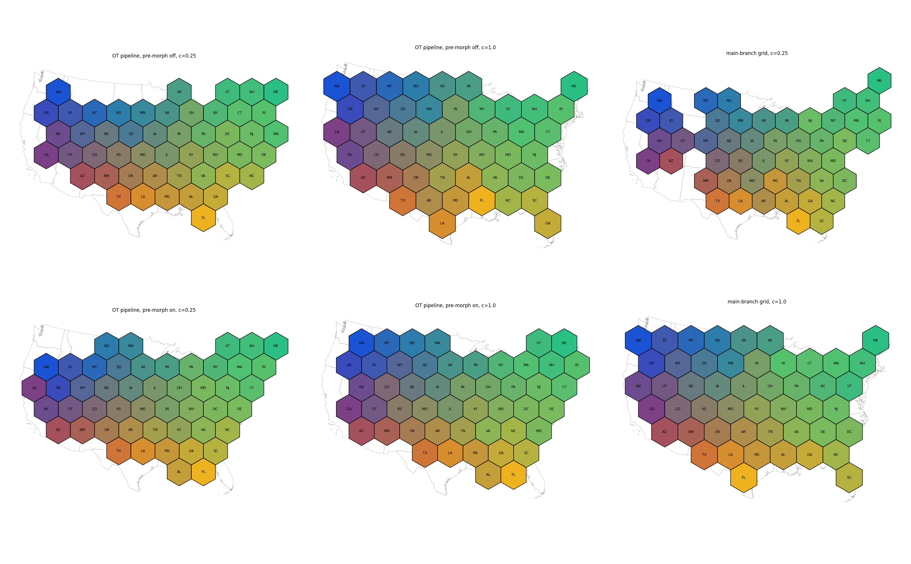
- 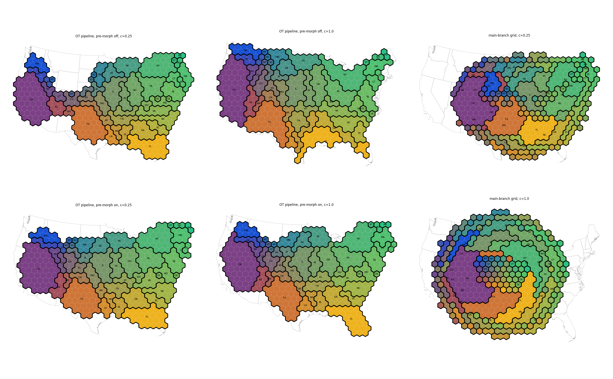
- 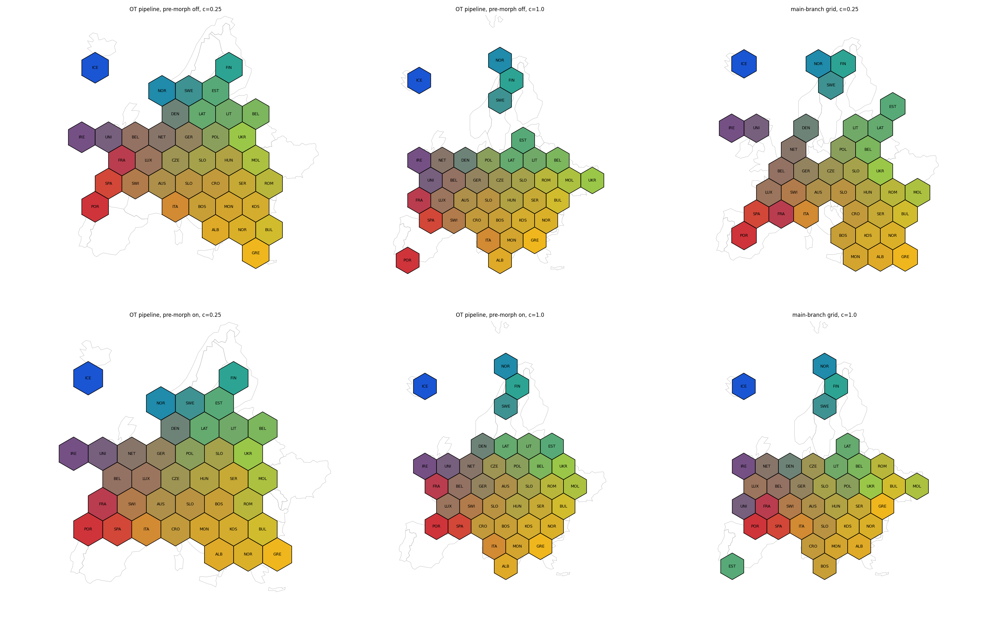
- 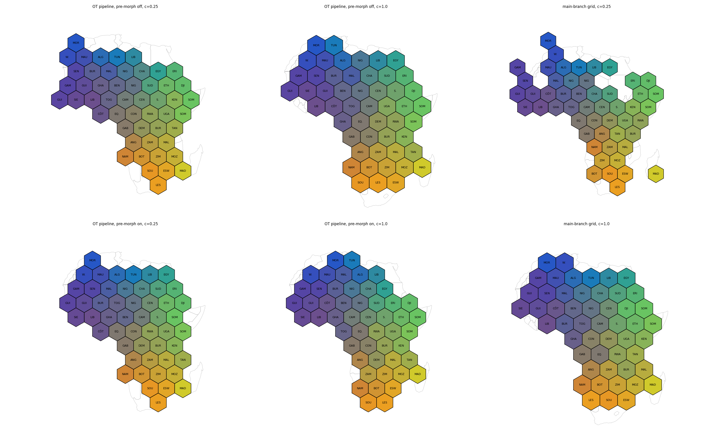

Visible defects: districts c = 1 without pre-morph: Louisiana is pushed into a thin tendril, Florida stretched along the Gulf, western states crowded. Africa: the Maghreb and the west coast shift east (Morocco above Mauritania), Madagascar sits next to Mozambique. Europe: Nordic tiles form a vertical strip at c = 1.

## Compactness is not linear

The allowed-set size is linear in c by construction; the metrics are not (hexagon, no pre-morph, c = 0 to 1 in steps of 0.1):
- States: mean displacement .62 to .71 for c = 0 to .8, then 1.12 at .9 and 1.49 at 1.
- Districts: 1.52 to 1.73 for c = 0 to .7, then 2.12, 2.76, 4.25 at .8, .9, 1.
- States with pre-morph: no knee (.75 to .85, then .91 at 1).
- The knee is where the allowed set shrinks below about 1.2 to 1.4 times n; the displacement rises steeply as the ratio n_allowed/n approaches 1.
- At c in [0, .1] the result is identical on states (the hull sink makes the lowest range redundant); pockets are noisy with no trend.

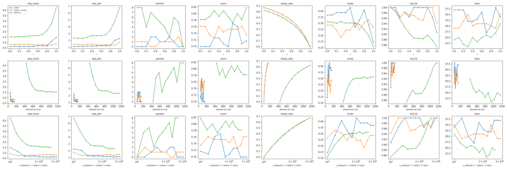

Suggested parametrization: spread the useful range with a geometric scale, `n_allowed = n (m/n)^(1 - c)`. On states c' = .8 gives ratio 1.24, where linear c = .9 does. Simpler: keep linear c and document c above .8 as the range where shape fidelity trades against displacement.

## Texas tip and feature preservation

- A tile exists at the Texas tip (nearest allowed tile 0.87 steps on states, 1.13 on districts); plain OT gives it to Louisiana because capacities trade tiles globally. The earlier extreme-direction test was ill-posed (the extreme tile in that direction belongs to Florida or Georgia); a nearest-tip test replaces it.
- Pre-morph is the most effective single change (states c = 1: displacement 1.48 to .91; districts: 2 split groups to 0, displacement 4.25 to 2.54).
- Extremes pinning (fixing the tiles at the extreme points of the outline to their regions) is nearly free on hexagon, costs more on square (1.72 against 1.44) and fails Maine and Washington there. Keep it optional; user-supplied landmark lists work the same way.
- Boundary alignment (matching boundary regions to boundary tiles in cyclic order) drops touching from .72 to .51 and splits 14 of 49 groups; dropped. The growth variant (grow regions from OT seeds) leaves 2 to 12 groups split and worse touching; dropped.

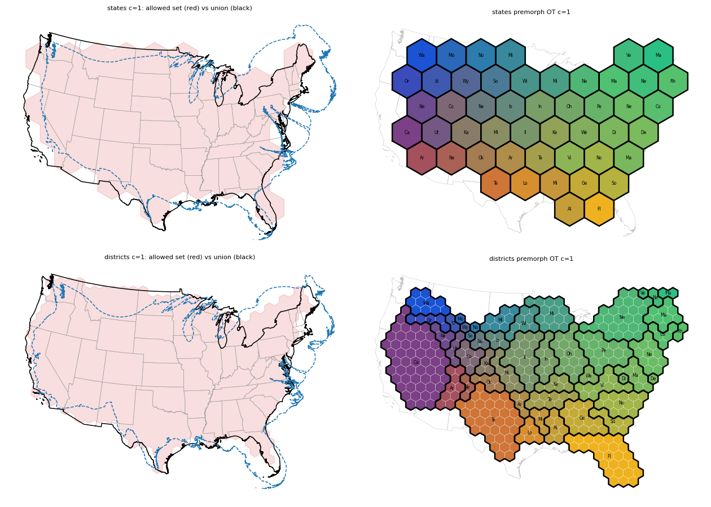
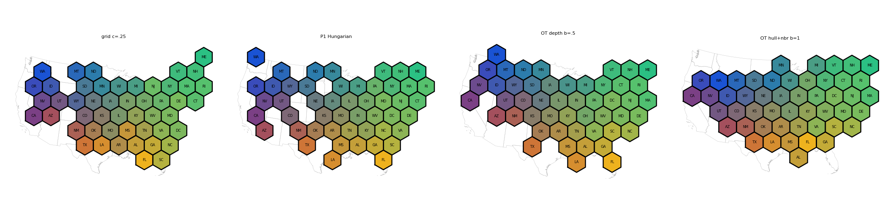
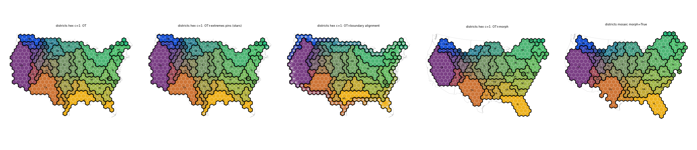

## Contiguity

Groups split (stray tiles) on districts by state:

| variant | hex c = 1 | hex c = .5 | square c = 1 | square c = .5 |
|---|---|---|---|---|
| OT raw | 5 / 9 | 2 / 2 | 10 / 22 | 6 / 7 |
| + local search | 2 / 6 | 0 / 0 | 2 / 12 | 0 / 0 |
| + chain moves | 1 / 5 | 0 / 0 | 2 / 12 | 0 / 0 |

Contiguity is not guaranteed at exactly n tiles (c = 1): Florida, and Florida with Georgia on squares, remain split. With any slack the search repairs all groups.

## Land parts, multi-part regions and the allowed set (Europe)

Europe without Russia has four land parts: the mainland (32 regions), Scandinavia (NOR, SWE, FIN), UK with Ireland, and Iceland. Findings:
- Parts must come from the original geometries. A pre-morph merges Scandinavia with the mainland in the morphed geometries.
- Part membership was not enforced in assignment or repair at first; the separate mode alone gave no gap. Enforcing membership (a region may only use tiles of its own part) is needed. With the spaced allocation it is the only separation approach that held up (see the next section).
- Multi-part regions: a main-part anchor plus capacity split by part area gives France 11 tiles plus 2 for French Guiana. Svalbard and similar parts need the same treatment.
- Compactness on a geometric scale, `n_allowed = round(n (m/n)^(1 - c))`, spreads the useful range (see above).

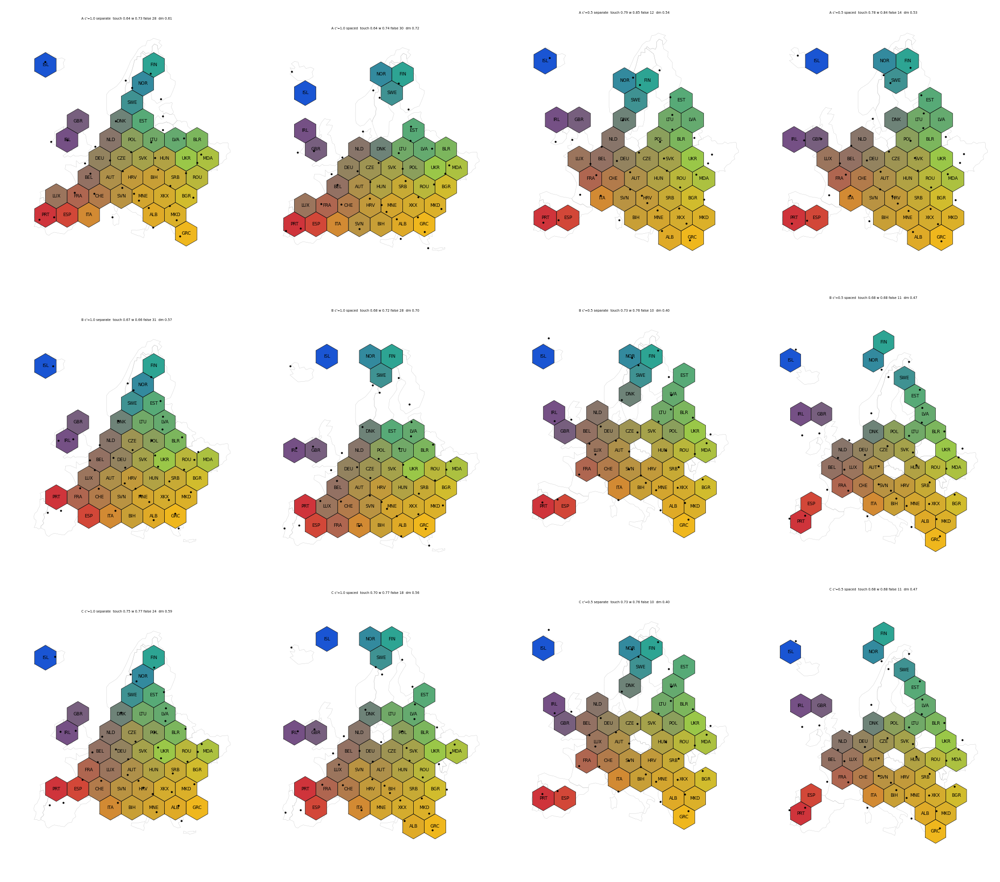

## Separating land parts: approaches tested

All on Europe first, then checked on the other datasets. None except enforced membership with spaced allocation survived.

| approach | outcome |
|---|---|
| water geometries (connected pieces, part pairs, region pairs, visible cross-part pairs) | number and placement of water pieces is ambiguous; Sweden-Denmark conflict; no gap in the south |
| fixed buffer around land | a bug moved Iceland; defined in tile space instead of original space |
| transferred buffer zone (pieces carried through the pre-morph) | works only with the pre-morph on |
| penalty for cross-part contact (weights 5 and 1.25) | helps Europe only; hurts South America and Asia; Portugal detaches, Norway and Sweden flip |
| exposure and direction labels (water side per region, hard and soft rule, four labelings) | hard rule hurts all datasets; soft rule trades false contacts for touching and pockets |
| landmarks and pins | work (Italy pin); "south of each part" pins Greece and Crete; stays an optional user input |

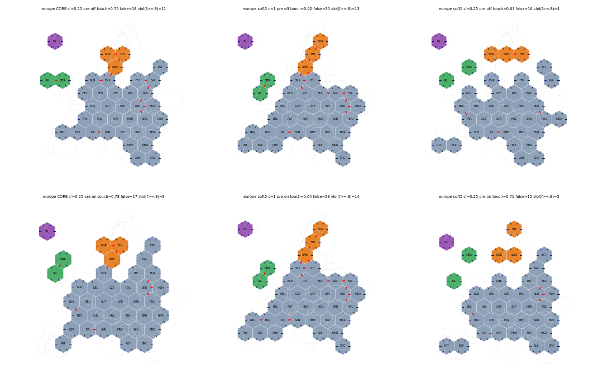
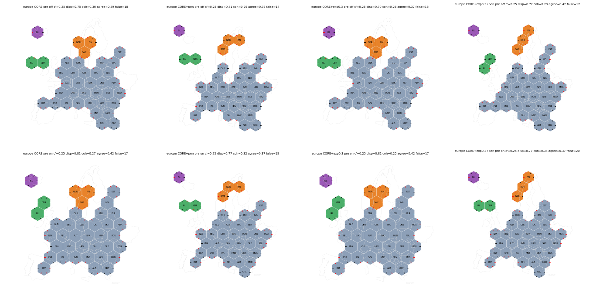
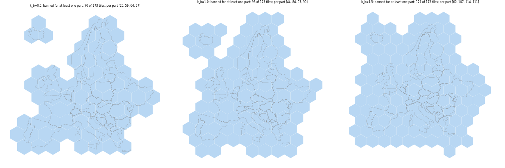

## Algorithm quality: upper bound and independent review

- **Annealing probe.** Simulated annealing on one fixed energy (0.5 times mean squared centroid displacement, 0.5 times mean squared hop gap of true neighbor pairs, 0.5 times share of non-adjacent touching pairs) improves the energy by 0 to 14 percent over Hungarian plus descent, with no visible gain. At c = 1 Hungarian plus descent is close to the optimum; at c' below 1 annealing is somewhat better.
- **Morph first.** Pre-morphing before assignment fixes outliers (Luxembourg, Texas tip) and adds 0.03 to 0.06 weighted touching on US states. It does not change touching on Europe or Africa.
- **Ceiling.** The degree bound sum_i min(deg_i, 6) / (2 P) is .95 on Europe and .97 on US states and says little. A review (Opus, read-only, no figures) estimates the real ceiling for one tile per region on hex tiles at 0.80 to 0.85 weighted touching, about 0.80 unweighted. Not proven; an exact ILP would settle it.
- **Review recommendation.** Mean touching is the wrong target. Use per-region acceptance tests (below).

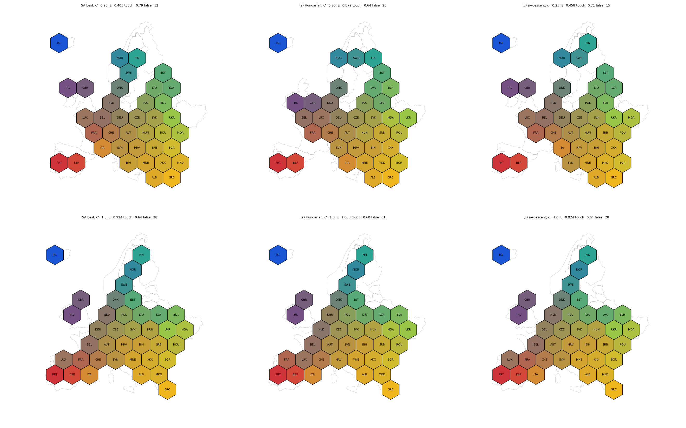

## Force-based layout of the target positions

Idea: replace the pre-morph by a force relaxation of region positions, then assign. Model: one node per region; vector springs on land-adjacent pairs toward the original offset (stiffness 1, scaled to tile units); finite-range pushes on water pairs (visible, non-adjacent, within 3 tiles; rest length 2 tiles; zero beyond 2; no pull); hard minimum spacing 0.92 tile; cap of 6 edges per region; edges crossing a third region weakened to 0.25; optional per-region anchor to the original centroid with stiffness ka. Weights were fixed once on states and Europe.

Findings:
- The first version barely moved the nodes (mean move 0.36 tile, 36 overlapping pairs). Spacing and a hard projection fixed that.
- The cap removed almost nothing. Weighting stiffness by shared border length (A-w) and per-region normalization (A-n) changed results in both directions; A-n does not converge (asymmetric forces drift 7 to 19 tiles between 4000 and 12000 iterations).
- A term described as a global alignment was in fact a per-region anchor (ka). Without it (A-k0) the layout does not rotate, mirror or fold (best rotation within -5 to +2.4 degrees). The anchor trades adjacency for displacement.
- With bare Hungarian assignment the interior holes below c = 1 return; the hull sink in the OT pipeline removes most of them (Europe 4 to 1 or 2, Africa 2 to 4 to 0).
- Land adjacency by a distance tolerance classed Sweden and Denmark (Oresund gap 0.024 tile) as land neighbors; the force model pulled them together and the touching metric rewarded the contact. Adjacency by shared border length (above 0.05 tile within a 0.01 tile buffer) fixes this and reclassifies, for example, SWE-DNK and HRV-ITA in Europe and NY-RI, ME-MA, CT-NJ, NJ-MD in the states. It also drops real borders lost to digitization mismatch (Chad-Niger is the clearest case); the threshold needs a tolerance study.
- Binary water gaps with no width threshold produce the expected gap between Great Britain and the mainland (BEL, NLD, FRA at hop 2). Sweden stays separated from Denmark for A and A-k03, not for A-k0 at c' = 0.5.

Weighted touching at c' = 0.5, OT pipeline with hull sink and the current descent (distance-tolerance adjacency; M uses its own pre-morph geometries):

| data | M | A (ka .3) | A-k03 | A-k0 |
|---|---|---|---|---|
| States | .854 | .857 | .792 | .788 |
| Europe | .779 | .748 | .819 | .794 |
| Africa | .724 | .765 | .777 | .777 |
| South America | .790 | .750 | .750 | .750 |
| Asia | .735 | .740 | .786 | .726 |

No force variant beats the morph everywhere; max displacement is mostly higher than the morph's (Europe 1.35 to 1.93 against 1.61). The Europe defects remain: Italy at 2 rows above its south tile, Nordic row, Scandinavia 1 to 2 hops from the mainland.

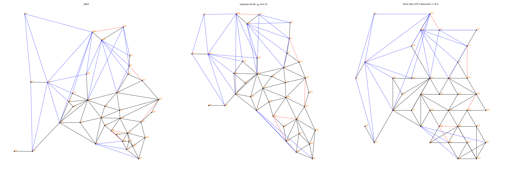

## The contact descent loses contacts

Diagnostic on Europe: after the OT stage Spain touched France (cost 0.03). The descent moved Spain to a farther tile because that removed a false contact (energy change -1.00, displacement +0.16 to +0.35, true contacts 0). Denmark moved one tile to fill a hole and lost Germany. Across 267 accepted moves that lose at least one true contact, the most negative term was false contacts in 115, the true-contact term in 107, displacement in 75, pockets in 17. The descent still gains more contacts than it loses (gains 12 to 27, loses 4 to 22 per run).

Protected descent (a move is rejected if the net true-contact count of the moved regions decreases; one setting, no tuning) restores Spain-France and Denmark-Germany:

| Europe c' = 0.5 | current plain / weighted | protected plain / weighted |
|---|---|---|
| A | .704 / .730 | .746 / .818 |
| A-k03 | .775 / .802 | .789 / .825 |
| A-k0 | .746 / .819 | .789 / .854 |

Cost: false contacts rise (15 to 17 become 18 to 22) and max displacement rises about 0.7 to 1 tile (to 2.0 to 2.2). Holes are unchanged. The protected descent also helps the morph baseline: weighted touching Europe .788 to .813, South America .739 to .783, Asia .720 to .747, Africa .697 to .706; it lowers states (.813 to .785). Tripling the true-contact term (W) is weaker and gives more false contacts.

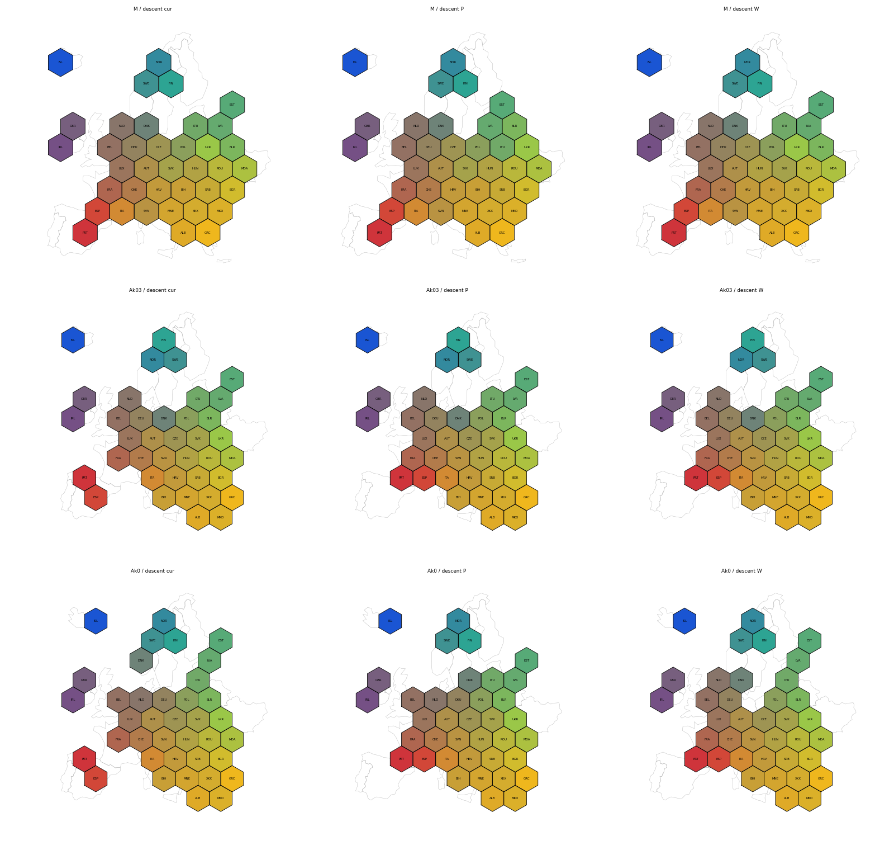
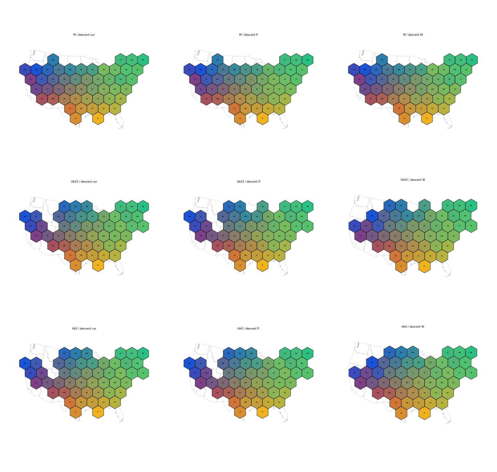

## Recommendation for 3.0.0

1. One tile per region: Hungarian assignment on centroids, then the contact descent. Decide whether to ship the protected-contact variant (higher touching on Europe, South America and Asia, higher false contacts and displacement).
2. Allocation: silhouette allocation with compactness on the geometric scale and enforced part membership; main-part anchors and capacity split for multi-part regions.
3. `tile_count` and `group_by`: capacitated OT with the hull reserve sink, contiguity-guarded swaps and chain moves. This unifies grid and mosaic.
4. Pre-morph: optional, off by default; recommended when region sizes vary a lot (US states).
5. Land adjacency for contact terms and metrics: shared border length, not a distance tolerance.
6. Not recommended: a force stage, water or buffer geometries, exposure or direction labels, a cross-part penalty, annealing.
7. Document the limits: Italy's boot, the Nordic row and Iberia's shape are not reproduced generally; about 75 to 85 percent of true neighbor pairs touch; a small region in a dense cluster can be one hop from its neighbors. Landmarks or pins are the supported fix and can follow after 3.0.

## Acceptance tests for a unified layout

Per-region tests replace mean touching as the target.

1. Zero split groups for `group_by` at c below 1, and at most 1 at c = 1 (documented).
2. Every region receives exactly its tile count.
3. On ungrouped input, mean displacement and touching no worse than the grid layout by more than 0.05 steps and .05 respectively (currently: touching lower on Europe and Africa without the contact descent).
4. Weighted touching at least 0.75; no region more than one hop from all of its true neighbors; maximum displacement about 1.5 steps or less.
5. Tip tiles (nearest tile to the outline extremes) belong to the owning region on states and districts.
6. Isolated parts (Alaska, Hawaii, Madagascar, Iceland) keep their tiles together and near their geometry in the modes separate, connected and spaced; separate land parts stay separate.

## Open items

- Contact descent on top of OT: prototyped (see above); open choice between the current and the protected-contact variant, and a tolerance study for the border-length adjacency.
- Descent on the force energy (vector springs, water pushes, border weights evaluated on tile centers) instead of the hand-built contact term: not tried.
- Multi-part geometries: capacity split by part area works for France; integrated splitting in the OT pipeline is open.
- Counties scale: sparse min-cost flow instead of dense Hungarian.
- Exactness at c = 1 (final repair or slack).
- Parametrization of c.
- Fate of PR 207 (silhouette allocation and inspection tool carry over; its energy assignment would be replaced).
- Separate topic: nested group cartogram (groups sized by their total, sub-regions laid out inside, groups separated like explode).

## What was not verified

- Michigan notch feature test; only 6 lattice offsets; square lattice shows the same picture with touching .45 to .55 on ungrouped data.
- Pre-morph left 2 invalid output regions on Europe (not repaired).
- Labels in the new figures are 3-letter truncations and ambiguous for small tiles.
- No test with multi-part groups or with counties; districts were not run in the force, water and descent experiments (the scratch pipeline there assumes one tile per region).
- The ceiling estimate (0.80 to 0.85) is a reviewer's estimate; the review read logs, not figures.
- Force experiments: the morph baseline uses its own pre-morph geometries; force variants move the original geometries to the relaxed positions; the tables mix distance-tolerance adjacency (earlier) and border-length adjacency (later); a timer glitch gives negative runtimes in two cells; the force weights were fixed on states and Europe only.
- Figures were checked by eye for Europe and states only; Africa, South America and Asia panels were produced but not inspected in detail.
- Several defects in the force and OT results (holes on states and Africa, misplaced tiles in Asia) were reported by the reader and not traced to a cause.
